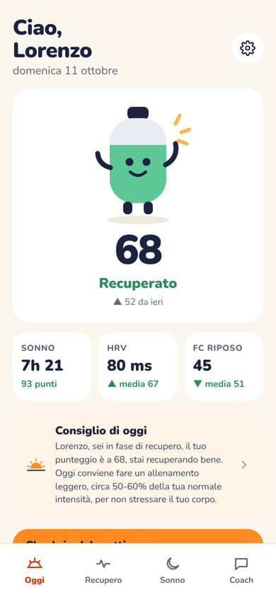
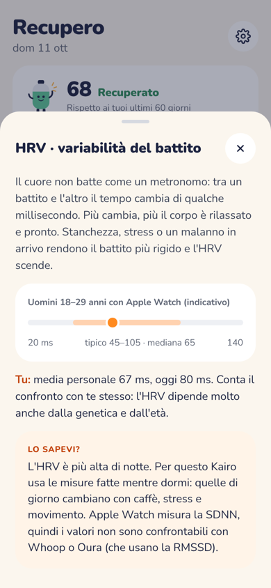
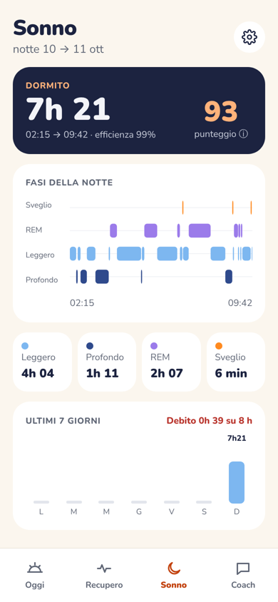
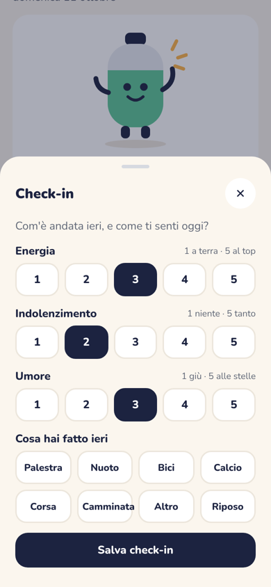

<p align="center">
  
</p>

<h1 align="center">kairo.</h1>

<p align="center"><b>Ogni giorno parte da come hai recuperato.</b><br>
Recupero, sonno e allenamento dai dati del tuo Apple Watch, con un coach IA.<br>
Open source, gratuito, i dati restano nel <i>tuo</i> account.</p>

<p align="center">
  <a href="https://deploy.workers.cloudflare.com/?url=https://github.com/antonuccilorenzogit/Kairo/tree/main/worker"></a>
</p>

<p align="center">
  
  
  
  
</p>

---

## Cos'è Kairo

*Kairós*, in greco, è il **momento giusto**. Kairo legge ogni mattina i dati del tuo Apple Watch (HRV, frequenza cardiaca a riposo, sonno, respirazione, attività) e ti dice **quanto hai recuperato** e **cosa conviene fare oggi**, confrontandoti con la *tua* media personale e non con quella degli altri.

È un'alternativa personale e open source ad app come Bevel, Whoop o Athlytic:

- **Score di Recupero 0–100** con Bean, la batteria che si riempie
- **Sonno**: fasi (ipnogramma), efficienza, regolarità, debito di sonno
- **Spiegazioni a richiesta**: tocca un dato per capire cos'è e come ti posizioni
- **Coach IA**: consiglio del giorno e chat che risponde con i tuoi numeri
- **Check-in in 10 secondi**: energia, indolenzimento, umore, cosa hai fatto ieri
- **Importa da Salute**: carica l'esportazione dell'app Salute, letta sul dispositivo
- **Diagnostica completa**: sincronizzazione, dati ricevuti, quota IA, versioni
- **App installabile** su iPhone e PC (PWA), funziona anche offline
- **Costo zero**: tutto sui piani gratuiti di Cloudflare e Groq

## Come funziona

```
 ⌚ Apple Watch ──► 📱 Salute ──► Comando "HealthSync" (automatico, 2 volte al giorno)
                                          │  POST JSON + codice di accesso
                                          ▼
                        ☁️ Il TUO Cloudflare Worker (gratuito, sempre acceso)
                           ├─ 🗄️ D1: il tuo database
                           ├─ 🧮 calcolo di recupero, sonno, baseline personali
                           ├─ 🤖 IA: Groq (la tua chiave) → riserva Cloudflare AI
                           └─ 🌐 serve la web app Kairo
                                          ▲
                      📱 iPhone / 💻 PC: l'app installata dal browser
```

- **Nessun server centrale**: ognuno pubblica la propria copia di Kairo sul proprio account Cloudflare, gratuito.
- **Le chiavi restano sui tuoi dispositivi**: il codice di accesso e la chiave Groq sono salvati nel browser e inviati solo al tuo server.
- **All'IA arrivano solo riassunti numerici**, mai i dati grezzi.

Dettagli tecnici in [docs/ARCHITETTURA.md](docs/ARCHITETTURA.md).

## Installazione in 4 passi (circa 15 minuti)

Serve: un **iPhone con Apple Watch**, un account **Cloudflare** e uno **GitHub** (entrambi gratuiti). La guida completa con screenshot è in [docs/SETUP.md](docs/SETUP.md).

1. **Pubblica il server.** Clicca il pulsante **Deploy to Cloudflare** qui sopra, accedi e conferma. Cloudflare crea il server, il database e ti dà un indirizzo tipo `https://kairo.tuonome.workers.dev`.
2. **Apri l'indirizzo** dall'iPhone, crea il tuo **codice di accesso** e, se vuoi, incolla una chiave gratuita di [Groq](https://console.groq.com/keys) per il coach IA.
3. **Installa il comando HealthSync** dalla guida dentro l'app. Durante l'importazione ti chiede indirizzo e codice. Poi crea le due automazioni (sveglia e carica) come spiegato nella guida.
4. **Aggiungi Kairo alla schermata Home**: in Safari tocca *Condividi → Aggiungi alla schermata Home*. Su PC: Chrome o Edge → *Installa app*.

Facoltativo ma consigliato: in *Impostazioni → Importa dati da Salute* carica l'esportazione dell'app Salute (`esportazione.zip`) per avere subito le tue medie personali. In alternativa puoi usare i 4 comandi **Storico**.

Dentro l'app c'è una **guida passo passo dalla A alla Z** (*Impostazioni → Guida*), con i pulsanti per scaricare i comandi e copiare indirizzo e codice.

## Costi

| Servizio | Piano | Uso tipico di Kairo |
|---|---|---|
| Cloudflare Workers | gratuito, 100.000 richieste/giorno | poche decine al giorno |
| Cloudflare D1 | gratuito, 5 GB | ~1 MB per anno di dati |
| Workers AI (riserva) | gratuito, ~280 risposte/giorno | solo se Groq non è disponibile |
| Groq | gratuito, ~1.000 richieste/giorno | 10–30 al giorno |

## Privacy e sicurezza

- I dati di salute sono salvati **solo nel tuo database Cloudflare**.
- Il server accetta richieste solo con il tuo codice di accesso (salvato come hash SHA-256).
- Nessun tracciamento, nessuna analytics, nessun font o script esterno: anche il font è incluso nel progetto.
- Puoi **esportare** tutti i dati in JSON o **cancellarli** dalle Impostazioni.

Leggi [docs/PRIVACY.md](docs/PRIVACY.md).

## Diagnostica

La pagina *Impostazioni → Diagnostica* controlla: raggiungibilità e latenza del server, versione dell'app e del server rispetto all'ultima release su GitHub, ultimo invio da iPhone per ogni comando, freschezza di ogni metrica, dimensione del database, chiave e modello IA, **richieste Groq rimaste oggi** e quando si azzerano, modello di riserva, installazione come app e funzionamento offline. Il pulsante *Copia report diagnostico* produce un riepilogo senza chiavi, da allegare alle segnalazioni.

## Domande frequenti

**Funziona con Android o con altri smartwatch?** Non ancora: i dati arrivano da Apple Salute tramite l'app Comandi. Il server accetta però qualsiasi JSON nel [formato documentato](docs/ARCHITETTURA.md#formato-dei-dati): un'integrazione con Health Connect è benvenuta.

**Devo dormire con il Watch?** È fortemente consigliato: sonno, respirazione e HRV notturna sono la base dello score. Senza, Kairo usa l'HRV delle ultime 24 ore e la FC a riposo.

**Perché i nomi dei dati nel comando sono in inglese?** Comandi usa identificatori interni in inglese indipendenti dalla lingua del telefono (per esempio `Active Calories`, non `Active Energy`).

**Kairo è un dispositivo medico?** No. Gli score sono stime basate sui sensori del Watch e non sostituiscono il parere di un medico.

## Sviluppo

```bash
git clone https://github.com/antonuccilorenzogit/Kairo && cd kairo/worker
npm install
npx wrangler dev          # server + app in locale su http://localhost:8787
npx wrangler deploy       # pubblica sul tuo account
```

- `worker/src/` — server (router, metriche, coach IA, schema del database)
- `worker/public/` — web app (JavaScript senza build, PWA)
- `tools/build_shortcuts.py` — genera e firma i comandi rapidi (non serve un Mac)
- `shortcuts/` — i comandi già firmati

Vedi [CONTRIBUTING.md](CONTRIBUTING.md) per contribuire.

## Licenza

[MIT](LICENSE) © [antonuccilorenzogit](https://github.com/antonuccilorenzogit) e contributori. Il font Nunito è distribuito con licenza SIL Open Font License 1.1. Apple, Apple Watch, Salute e Comandi sono marchi di Apple Inc.; Kairo non è affiliato ad Apple.
